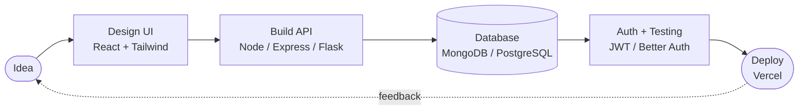
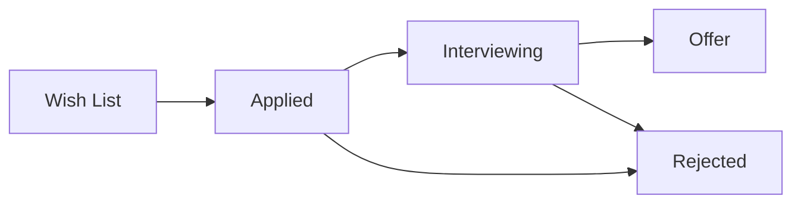

  

**B.Tech Computer Science & Engineering · 2027**  
Full-stack development · Backend engineering · Python and machine learning

  

> I build practical web applications and Python-based machine-learning projects, with a focus on clear user experiences, reliable APIs, and maintainable code.

---

## About

I'm a B.Tech Computer Science and Engineering student at Aryan Institute of Engineering and Technology (BPUT), graduating in 2027. I enjoy working across frontend interfaces, backend services, databases, and application workflows to turn ideas into usable software.

My internship experience includes **Python and AI at Oditech Global Pvt. Ltd.** and **Frontend Development at Canien Tech**. I'm continuing to strengthen my software engineering fundamentals through hands-on projects and collaborative development.

- **Seeking:** Software engineering internships and entry-level full-stack, frontend, backend, or Python development roles.
- **Building with:** JavaScript, React, Node.js, Express, Python, Flask, MongoDB, and PostgreSQL.
- **Currently improving:** Data structures and algorithms, API design, testing, database modelling, and maintainable code.

## Technology

  

| Focus | Technologies |
|---|---|
| Languages | JavaScript, Python, SQL |
| Frontend | React, Redux Toolkit, HTML, CSS, Tailwind CSS |
| Backend | Node.js, Express.js, Flask, REST APIs |
| Databases | MongoDB, Mongoose, SQL |
| Data and ML | Pandas, NumPy, scikit-learn, K-Means |
| Tools | Git, GitHub, VS Code, Postman, Vercel |

### How I build an application

---

## Featured projects

### 1. MusicFy — Role-based music application

A full-stack music application with listener and administrator workflows, music management, authentication, and media uploads.

**Technologies:** React · Node.js · Express · MongoDB · Mongoose · JWT · ImageKit

- Developed the application as a full-stack project.
- Worked with role-based access and authentication flows.
- Integrated backend APIs and media upload functionality.

[**Open live application**](https://musicfy-mu.vercel.app/?#/) · [Source code](https://github.com/sourav-07-s/CompleteFullStack/tree/main/RoleBasedAuth_project)

### 2. Customer Segmentation System — Retail analytics

A retail analytics project using Recency, Frequency, and Monetary (RFM) features and K-Means clustering to group customers by purchasing behaviour.

**Technologies:** Python · Pandas · scikit-learn · Flask · SQLAlchemy · PostgreSQL / Supabase

- Works with customer transaction data and RFM features.
- Uses clustering to identify customer segments.
- Intended to support customer analysis and marketing decisions.

[Browse my repositories to find this project](https://github.com/sourav-07-s?tab=repositories)

### 3. ShopAssist — E-commerce application

A React-based shopping application focused on product discovery and core shopping workflows.

**Technologies:** React · JavaScript · Redux Toolkit · Tailwind CSS · React Router

[**Open live demo**](https://shopassist-mu.vercel.app/) · [Source code](https://github.com/sourav-07-s/shopassist)

### 4. Email Spam Detection — Machine learning

A text-classification application that uses preprocessing and TF-IDF features with Logistic Regression to classify messages as spam or legitimate.

**Technologies:** Python · Flask · Pandas · scikit-learn · TF-IDF · Logistic Regression

[Source code](https://github.com/sourav-07-s/Email-Spam-Detection-Model)

### 5. React Blog Platform

A blog application built with React, Redux Toolkit, and Appwrite.

**Technologies:** React · Redux Toolkit · Appwrite

[Source code](https://github.com/sourav-07-s/ReactProject--Blog)

---

## Currently building

### Job Tracker — Job application management

**Status: In progress**

A personal job-application tracker organised around a Kanban-style workflow. The board currently uses the stages Wish List, Applied, Interviewing, Offer, and Rejected.

**Technologies:** Next.js · JavaScript · MongoDB · Mongoose · Better Auth · Tailwind CSS

**Current focus:** Authentication and session handling, user-specific board setup, and persistent job application data. This project is still under development; features are not described as complete until implemented and tested.

---

## GitHub activity

The cards below are generated from public GitHub activity. The animations are entrance effects; they respect reduced-motion settings where supported.

  

| GitHub statistics | Languages by repository |
|---|---|
|  |  |

### Streak and most-used languages

  
  

### Contribution graph

  

### Trophies

  

### Contribution snake

  <picture>
    <source media="(prefers-color-scheme: dark)" srcset="https://raw.githubusercontent.com/sourav-07-s/sourav-07-s/output/github-contribution-grid-snake-dark.svg" />
    <source media="(prefers-color-scheme: light)" srcset="https://raw.githubusercontent.com/sourav-07-s/sourav-07-s/output/github-contribution-grid-snake.svg" />
    
  </picture>

---

## Experience

- **Oditech Global Pvt. Ltd.** — Python and AI internship.
- **Canien Tech** — Frontend Development internship.

## Connect

<i>Build useful things. Learn continuously. Improve through feedback.</i>

